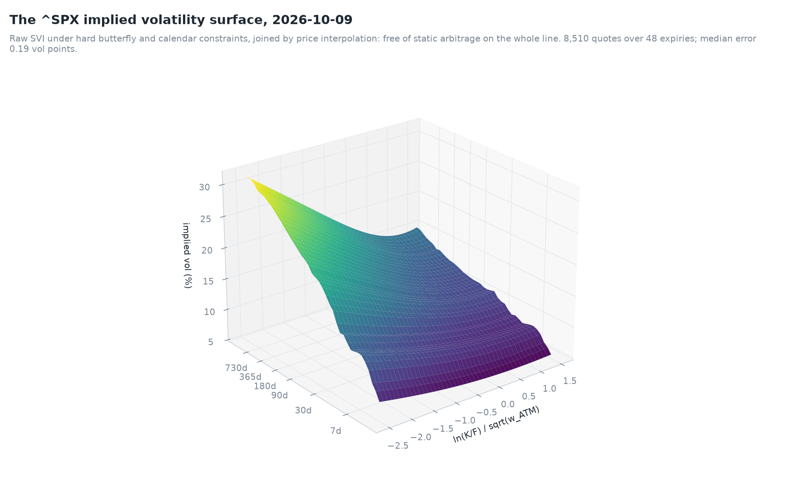
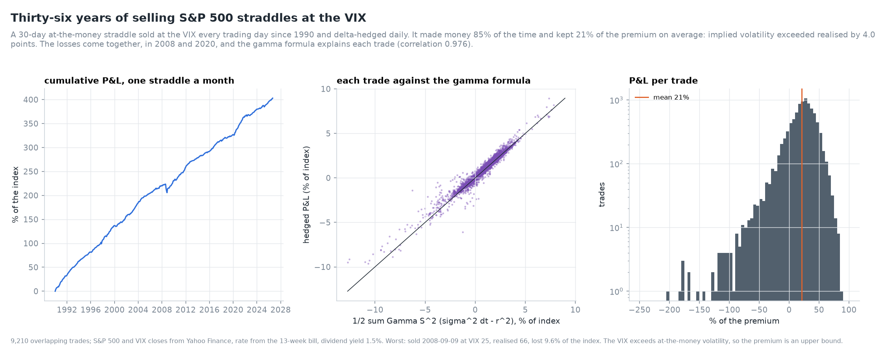
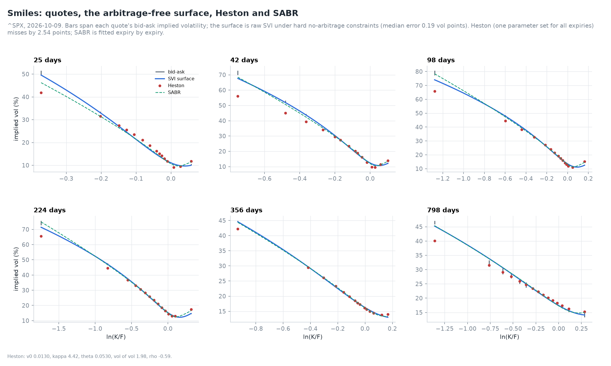
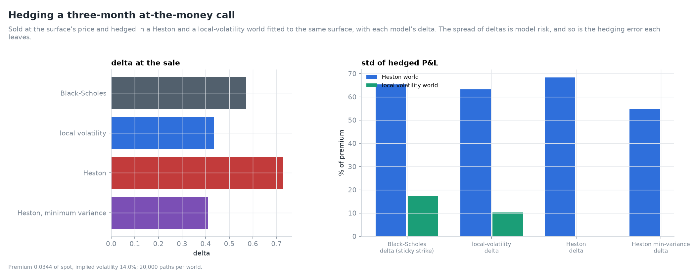
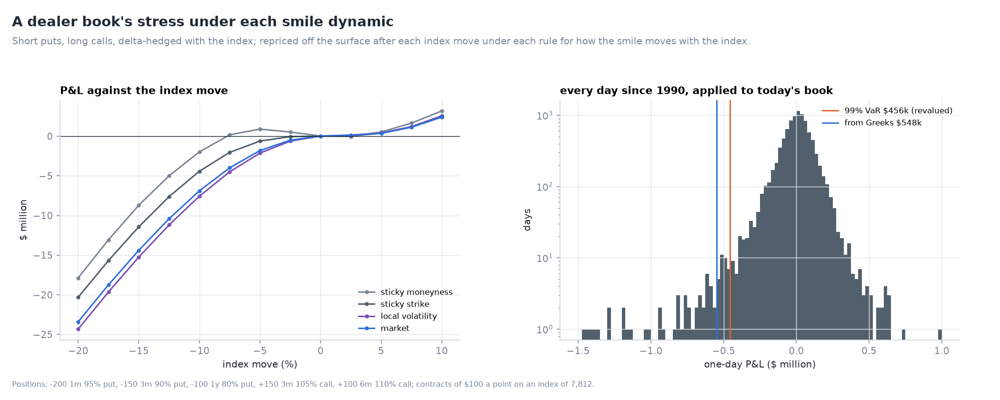
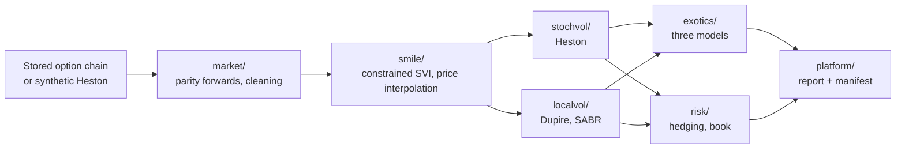

# Volatility Surface Lab

[](https://github.com/elmarfarajov/volatility-surface-lab/actions/workflows/ci.yml)


[](https://github.com/elmarfarajov/volatility-surface-lab/releases)


**From raw option quotes to an arbitrage-free volatility surface, four models of it, the exotics and hedges
they disagree on, and the risk of an options book - every engine held to a reference it shares no code with.**

`volsurf analyze` takes a stored S&P 500 option chain through the whole stack in one reproducible run:

- forwards and discount factors from put-call parity;
- raw SVI under hard no-arbitrage constraints;
- Heston, SABR and Dupire local volatility;
- seven exotics priced under three models;
- a call hedged in each model's world with each model's delta;
- a dealer book's stress and historical value at risk.

It writes an HTML report and a manifest that lets `volsurf reproduce` rerun it and check every number.



---

## Built day by day

The lab was rebuilt and deepened over nine days in October 2026, one area of the stack a day. Each
day holds its area to references it shares no code with: published worked examples,
QuantLib, arbitrary-precision arithmetic, real market data, or properties that must
hold for any input. The plan and each day's results are in the [roadmap](docs/ROADMAP.md),
the charts in the [gallery](docs/GALLERY.md), and the decisions in the
[architecture decision records](docs/adr/README.md).

| Day | Area | Status |
|---|---|---|
| 1 | The analytic foundation: one model for every underlying, seventeen Greeks, three references | ✅ v1.1.0 |
| 2 | Numerical engines: lattices, finite differences, Monte Carlo, with corrected references | ✅ v1.2.0 |
| 3 | Implied volatility and real option chains: an exact inverse, parity forwards, clean quotes | ✅ v1.3.0 |
| 4 | The arbitrage-free surface: SVI under hard constraints, price interpolation, densities | ✅ v1.4.0 |
| 5 | Heston: prices to the last digit, identifiable calibration, QE simulation | ✅ v1.5.0 |
| 6 | Local volatility and SABR: closed-form Dupire, Hagan against the model, smile dynamics | ✅ v1.6.0 |
| 7 | Exotic options: closed forms against QuantLib, corrected Monte Carlo, three models of one surface | ✅ v1.7.0 |
| 8 | Hedging and model risk: every model's hedge in every model's world, 36 years of data, a book's risk | ✅ v1.8.0 |
| 9 | The platform: one reproducible analysis, report and manifest; the dashboard; the wheel tested alone | ✅ v1.9.0 |
| 7 | Exotic options | next |
| 8 | Hedging and model risk | |
| 9 | The platform | |

**Day 1: the analytic foundation.**

- **One model for every underlying.** Generalised Black-Scholes-Merton prices options on
  stocks, indices, futures, currencies and margined futures through the cost of carry.
- **Seventeen Greeks to third order**, each checked three ways:
  - against the price differentiated to 50 digits with mpmath, agreeing to 1e-14;
  - against QuantLib on 500 random contracts;
  - against Haug's (2007) worked examples, reproduced to the printed digit.

The arbitrary-precision reference caught two Greeks, veta and color, with their signs
turned: as usually printed, they are derivatives in time to expiry rather than in time
passing. At expiry the Greeks are now their limits, where the original code divided by
zero.


The full account is in [the analytic foundation](docs/notes/the-analytic-foundation.md).

**Day 2: numerical engines.**

- **Lattices:** five trees with European, Bermudan and American exercise, and BBSR.
- **Finite differences:** Crank-Nicolson with Rannacher smoothing, the cure for a gamma
  that rings at the strike.
- **Monte Carlo:** randomised quasi-Monte Carlo, and least-squares Monte Carlo
  bracketed by a lower and a dual upper bound.

The American references are now high-precision values. Measured against them,
Longstaff and Schwartz's (2001) widely quoted finite-difference column turns out, in 15
of its 20 cases, to be the price of a **Bermudan** put exercisable fifty times a year,
0.003 to 0.009 below the American.


The full account is in [numerical engines](docs/notes/numerical-engines.md).

**Day 3: implied volatility and the market.**

- **An exact Black function:** computed through the Mills ratio, so it never subtracts two
  nearly equal prices. The textbook formula keeps nine digits of sixteen at small
  volatility.
- **An exact inverse:** a Jaeckel-style inversion within 4.0 condition numbers of the
  truth on every well-posed quote, against 4.1 for Jaeckel's own code. The v1.0 Newton
  iteration was wrong by 18% at a price of 1e-20 and by a factor of four at 1e-300.
- **Clean real chains:**
  - forwards and a discount curve from put-call parity across 53 SPX expiries;
  - every quote kept or dropped for a stated reason;
  - strike arbitrage tested where it could be traded, at the bid and the ask.

Yahoo Finance's own implied volatilities turn out to assume zero rates and dividends:
off by about four volatility points beyond a year, in opposite directions for puts and
calls.


The full account is in [implied volatility and the market](docs/notes/implied-volatility-and-the-market.md).

**Day 4: the arbitrage-free surface.**

- **The original surface had arbitrage.** Checked on the whole real line, its penalised SVI
  fit left a negative density in 36 of 48 S&P 500 slices and crossings in 31 of 47 pairs.
  Between expiries its interpolation reached `g = -3.9`.
- **Hard constraints instead of penalties:** raw SVI fitted by the exchange method,
  arbitrage-free on every slice, at 0.19 vol points of median error against 0.16 for the
  unconstrained fit.
- **Prices between expiries:** Gatheral and Jacquier's price interpolation, with a
  log-normal convolution beyond the last expiry. Every intermediate smile is a valid
  distribution.


The full account is in [the arbitrage-free surface](docs/notes/the-arbitrage-free-surface.md).

**Day 5: Heston.**

- **Prices to the last digit.** Each side is priced out of the money by a contour integral,
  within 1e-14 of a 40-digit reference in both wings. The v1.0 engines were about 100% wrong
  for a deep ten-year call. Along the way, Fang and Oosterlee's widely used reference price
  turned out to be off in its eighth digit.
- **Calibration that says what it knows.** On the S&P 500, every start reaches the same
  minimum, but mean reversion is fixed only to a factor of two, and Heston misses the
  surface by 2.5 vol points.
- **Simulation below the Feller boundary.** QE stays within noise where Euler is a hundred
  standard errors out.


The full account is in [Heston](docs/notes/heston.md).

**Day 6: local volatility and SABR.**

- **Local volatility in closed form**, from the arbitrage-free surface, and repriced by the
  forward Dupire equation to within a few basis points. On the way: the Day 4 interpolation
  keeps an atom before its first expiry, which no diffusion can carry.
- **SABR held to the model.** Against an exact reference, Hagan's formula is off by 4 bp at
  five weeks and over 400 bp at two years, and at long maturities it implies negative
  densities.
- **Smile dynamics, measured.** Local volatility moves the at-the-money volatility against
  the index by twice the skew, and SABR moves it with the index. The same smile gives
  at-the-money deltas from 0.39 to 0.63.


The full account is in [local volatility and SABR](docs/notes/local-volatility-and-sabr.md).

**Day 7: exotic options.**

- **Closed forms held to QuantLib**: barriers, geometric Asians, lookbacks and digitals,
  to 1e-12 or better.
- **Monte Carlo held to the closed forms.** The Brownian bridge recovers continuous
  monitoring from a monthly grid. The BGK correction holds daily but overprices a near
  up-and-out by 22% monitored quarterly.
- **A reference that is not.** QuantLib's Choi Asian engine, converged in its parameters,
  is 0.40% low at 52 fixings, against two Monte Carlo engines that agree.
- **One surface, three models.** Heston and local volatility price the S&P 500
  at-the-money call within 0.2% of each other and a 120% up-and-out call 35% apart.


The full account is in [exotic options](docs/notes/exotic-options.md).

**Day 8: hedging and model risk.**

- **Model risk as a hedging error.** Fitted to the same S&P 500 surface, the models give a
  three-month call deltas from 0.41 to 0.73. Hedged daily, the error is 10% of the premium
  in a local-volatility world and at least 56% in the calibrated Heston world.
- **Thirty-six years of the VIX.** Delta-hedged short straddles made money 85% of the time,
  and the gamma formula explains each trade. The smile moves 1.8 times as far as sticky
  strike, and the minimum-variance delta that follows removes 40% of hedging-error
  variance.
- **A book's risk.** The smile dynamic changes a 10% stress from $2.0m to $7.6m. Eight
  Greeks explain quiet days, but they misstate crashes in both directions.



The full account is in [hedging and model risk](docs/notes/hedging-and-model-risk.md).

**Day 9: the platform.**

- **One analysis over every engine.** `volsurf analyze` runs Days 3 to 8 on a stored
  snapshot and writes a report, figures, tables and a manifest. The v1.0 pipeline is
  retired.
- **Every number can be got again.** `volsurf reproduce` rebuilds the SHA-256-fingerprinted
  input, reruns, and compares every number: 52 of 52 on the S&P 500.
- **The dashboard and the package.** The dashboard is rebuilt over every engine and works
  offline. CI installs the wheel without the development extras and runs the platform
  from it.

The full account is in [the platform](docs/notes/the-platform.md).

## Results on the S&P 500

`volsurf analyze --ticker ^SPX --day 2026-10-09`, on the snapshot of 9 October 2026 (spot 7,811.54; Yahoo
Finance, delayed). The run's manifest is fingerprinted to SHA-256 `2e3f5847ca40...`; it took under five minutes.

| Stage | Result |
|---|---|
| Market (Day 3) | 8,510 cleaned quotes on 48 expiries from three days to three years; rates 4.2-5.3% and carry from parity |
| Surface (Day 4) | raw SVI under hard constraints: median error **0.19 vol points**, worst slice 0.69; butterfly and calendar margins non-negative on the whole line |
| Heston (Day 5) | 8 Sobol' starts reach v0 0.0130, kappa 4.42, theta 0.053, vol of vol 1.98, rho -0.59; **RMSE 2.54 vol points** - one diffusion cannot fit a one-week and a three-year skew |
| SABR (Day 6) | 13 expiries; median vol of vol 1.32, median rho -0.59 |
| Exotics (Day 7) | Heston and local volatility price the at-the-money call within 0.7% of each other, but the 120% up-and-out call **38% apart** (0.0469 against 0.0340 of spot) |
| Hedging (Day 8) | a three-month call's delta is 0.41 to 0.73 depending on the model; daily hedging leaves **10%** of the premium in a local-volatility world and at least **54%** in the calibrated Heston world |
| Book risk (Day 8) | a dealer book loses **$2.0m to $7.6m** in a 10% fall, depending on how the smile moves; one-day 99% VaR $456k revalued, $548k from Greeks |







The report's other figures - term structure, densities and local volatility, the Heston residuals and the
exotics - are in [docs/images](docs/images) as `report-*.png`, and the full reasoning is in the day notes.

---

## What is inside



| Module | Contents |
|---|---|
| `analytic/` | Generalised Black-Scholes-Merton for every carry convention; seventeen Greeks to third order with limits at expiry; Merton's bounds; an arbitrary-precision reference and Haug's published examples |
| `numerics/` | Five lattices with BBSR; Crank-Nicolson with Rannacher and early exercise; Monte Carlo with randomised quasi-random sampling and bracketed least-squares; high-precision American and Bermudan references |
| `market/` | The Black function through the Mills ratio; implied volatility exact to its conditioning; forwards and discount curve from parity; chain snapshots and cleaning with stated reasons |
| `smile/` | SVI in three parameterisations with whole-line arbitrage checks; SSVI and eSSVI; raw SVI under hard constraints; price interpolation in time; risk-neutral densities |
| `stochvol/` | Heston: the characteristic function and its moment strip; out-of-the-money prices by contour integral; calibration with identifiability diagnostics; Euler and QE simulation |
| `localvol/` | Dupire local volatility in closed form and the forward equation that checks it; SABR with an exact reference; smile dynamics and deltas |
| `exotics/` | Barrier, Asian, lookback and digital closed forms; Monte Carlo under Black-Scholes, Heston and local volatility with the Brownian bridge, BGK and control variates; exotic model risk |
| `risk/` | Self-financing hedging in any model's world; Heston and local-volatility Greeks along paths; minimum-variance deltas; S&P 500 and VIX backtests; P&L explain, stress and historical VaR of a book |
| `platform/` | The analysis over every engine; fingerprinted sources; the HTML report; the manifest and `volsurf reproduce` |
| `gallery/` | The documentation's charts, registered by day and redrawn with `volsurf gallery` |
| `validation.py` | 52 checks against published benchmarks and independent methods |
| `heston.py`, `black_scholes.py`, `monte_carlo.py`, `lattice.py`, `implied_vol.py`, `market_data.py` | The v1.0 engines, kept as independent cross-checks of the rebuilt ones, and the synthetic-chain generator |
| `legacy/` | The v1.0 SVI and surface, kept only to reproduce the arbitrage Day 4 found in them |
| `app/streamlit_app.py` | Dashboard over every engine: pricer, surface, models, exotics, hedging and book risk |

## Engineering decisions worth noting

- **Forwards come from the market, not from assumptions.** Regressing C - P on K per expiry recovers D and F,
  so discrete dividends and funding costs never need to be modelled.
- **The COS interval is sized from the exact variance of log returns**, computed from the characteristic
  function itself. An approximate cumulant formula tried first was 30% too small at high vol-of-vol and cost
  three to four digits of accuracy; the published benchmark is now matched to 3e-8.
- **Heston Greeks for thousands of paths in one pass.** Splitting the characteristic function as
  exp(A(u) + B(u) v) means one set of exponents serves every path, and delta and dV/dv fall out of the same
  cosine series. Bucketing paths by variance made this about 20x faster.
- **Implied volatility never fails silently.** Quotes violating static bounds return NaN; every quote with a
  numerically meaningful time value converges, from one-day to five-year expiries and out to 1.5 log-moneyness.
- **Regularisation with a reason.** The SVI curvature parameter is floored at the strike spacing, because
  curvature finer than the quote grid is not identified by the data and otherwise creates spikes in the
  implied density.
- **Plots show the market, not extrapolation.** Surfaces are drawn in standardised moneyness k/sqrt(T) over
  the window that expiries actually quote.

## Numerical validation

Run `volsurf validate`. Full output: [docs/VALIDATION.md](docs/VALIDATION.md) - 52 checks, all passing. A
selection:

| Check | Reference | Result |
|---|---|---|
| Seventeen Greeks | the price differentiated to 50 digits (mpmath) | 1.1e-14 |
| Implied volatility, 20,000 random quotes | round trip | 3.3e-12 |
| American puts, BBSR | Andersen-Lake-Offengenden, 20 contracts | 3.4e-5 |
| Heston, contour integral | Lewis's integral to 40 digits | 1.3e-11 relative, wings included |
| Heston, Fang and Oosterlee's published price | the same price to 40 digits | 3.6e-15; the printed value is wrong in its eighth digit |
| Dupire round trip | the surface's own implied volatilities | 1.0 bp |
| SABR exact reference | QuantLib's SABR PDE | 17.7 bp, MC standard error 5.0 bp; Hagan off by 52 bp |
| Barriers | QuantLib, 400 random contracts | 5.7e-14 |
| Arithmetic Asian | QuantLib's Monte Carlo | 0.4 standard errors |
| Hedging at the wrong volatility | the gamma P&L formula, path by path | correlation 0.996 |
| The platform | its own recorded run | every number reproduced to 1e-6 |

The tests run on Python 3.10-3.12 in CI, with linting, strict typing, the validation suite, and the installed
wheel run on its own.

## Quickstart

```bash
git clone https://github.com/elmarfarajov/volatility-surface-lab.git
cd volatility-surface-lab
python -m venv .venv
source .venv/bin/activate            # Windows: .venv\Scripts\activate
pip install -e ".[dev,app]"
```

```bash
# Offline: the whole analysis on a synthetic Heston chain (--quick: under a minute)
volsurf demo --quick --out reports/demo
volsurf reproduce reports/demo

# The S&P 500: store today's chain (and, for the book's VaR, the index and VIX history), then analyse it
volsurf chains fetch ^SPX
volsurf history fetch
volsurf analyze --ticker ^SPX --out reports/SPX
volsurf reproduce reports/SPX

# Price one contract with every engine; one option's seventeen Greeks
volsurf price --spot 100 --strike 95 --maturity 0.5 --rate 0.03 --vol 0.25 --heston 0.0625,2,0.0625,0.3,-0.5
volsurf greeks --spot 100 --strike 100 --maturity 1 --rate 0.05 --vol 0.2

# Validation, tests, the gallery, the dashboard
volsurf validate
pytest
volsurf gallery
streamlit run app/streamlit_app.py
```

Each analysis writes `report.html` (with an interactive surface), `figures/*.png`, `tables/*.csv`, and
`manifest.json`: the source's SHA-256, the configuration, the code and library versions, and every number
the report quotes.

> On Windows, keep the virtual environment in a folder whose path contains only ASCII characters; the
> `curl_cffi` dependency of `yfinance` cannot open certificate files under non-ASCII paths.

## Project layout

```
volatility-surface-lab/
├── src/volsurf/          # the library (see the table above)
├── app/                  # Streamlit dashboard
├── tests/                # unit, property, statistical, end-to-end and dashboard tests
├── docs/
│   ├── notes/            # one methodology note per day
│   ├── adr/              # architecture decision records
│   ├── GALLERY.md        # every chart, rebuilt by `volsurf gallery`
│   ├── VALIDATION.md     # the validation suite's results
│   └── ROADMAP.md        # the nine days
└── .github/workflows/    # lint, strict typing, tests on three Pythons, validation, the wheel on its own
```

Stored snapshots, history and reports live in the git-ignored `data/` and `reports/`.

## Limitations and next steps

- Yahoo Finance quotes are delayed and not synchronous across strikes; the stored snapshots are a few, not a history.
- Heston cannot fit the short-dated S&P 500 skew (2.5 vol points). Bates (jumps) and rough Bergomi are the
  natural next models; both fit the platform through a characteristic function or a simulator.
- The VIX backtests use the VIX as a proxy for at-the-money volatility; a history of option quotes would replace it.
- Hedging ignores transaction costs, and the book's historical scenarios move the smile in moneyness only.

Derivations and references for every method: the [day notes](docs/notes) and
[docs/METHODOLOGY.md](docs/METHODOLOGY.md).

## About

Built by Elmar Farajov as an independent research project in quantitative finance, following
[Portfolio-analyzer](https://github.com/elmarfarajov/Portfolio-analyzer) (portfolio risk and fixed income)
and [equity-valuation-engine](https://github.com/elmarfarajov/equity-valuation-engine) (DCF and Monte Carlo
valuation). Research and educational use only; not investment advice. Licensed under [MIT](LICENSE).
