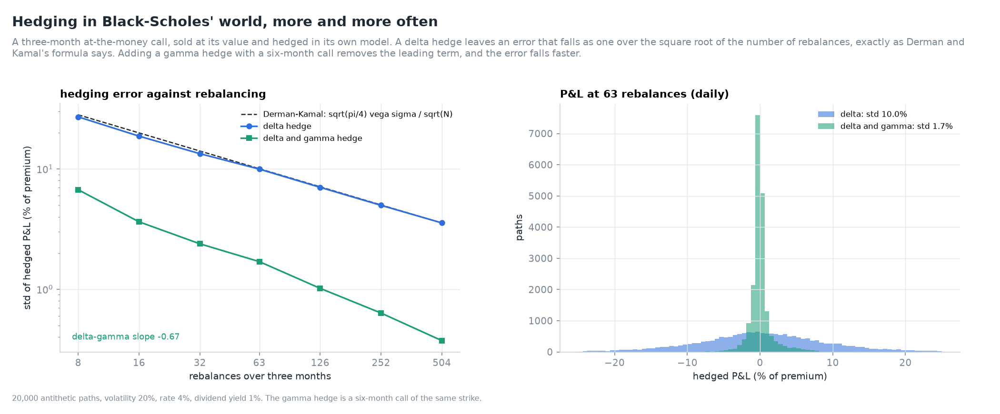
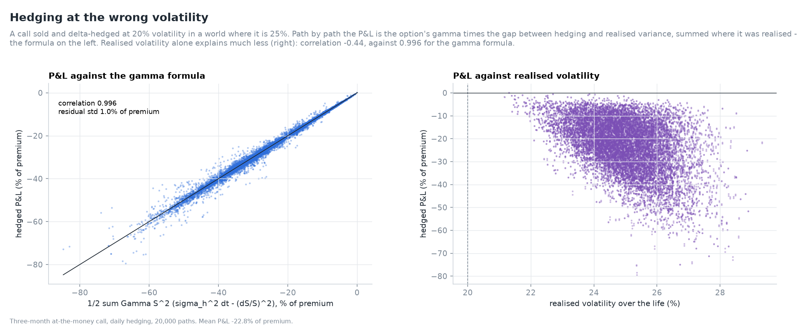
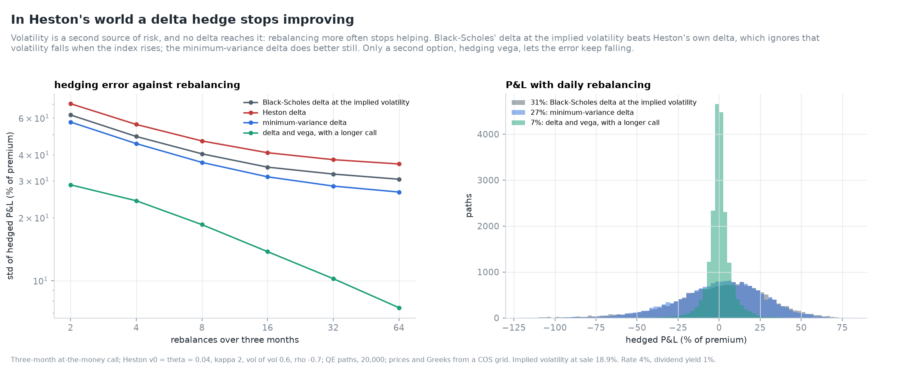
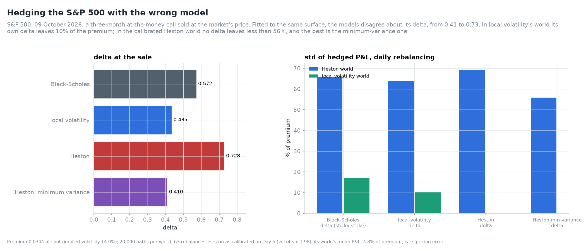
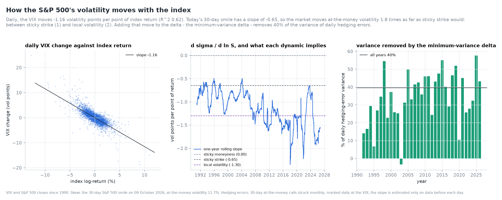
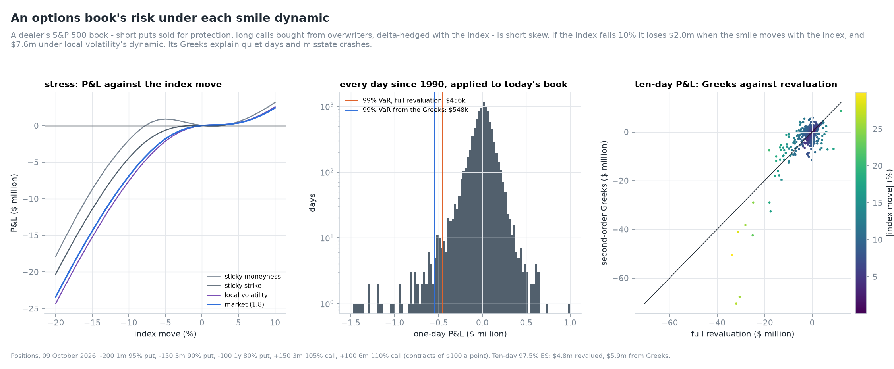

# Hedging and model risk: how much risk a hedge removes, under each model and on thirty-six years of data

Days 4 to 7 priced options off one S&P 500 surface under three models. Day 8 asks what a
dealer who sells an option can do about its risk, and how much the answer depends on the
model.

- **Simulation** measures hedging error in each model's world, with each model's hedge.
- **Data** check two things on the index and the VIX since 1990: what hedged short
  volatility earned, and how volatility actually moves with the index.
- **An options book's** Greek explain, stress ladder and historical value at risk show
  where the Greeks stop being enough.

---

## 1. In Black-Scholes' world: Derman and Kamal, and a gamma hedge

A three-month at-the-money call is sold at its value and delta-hedged `N` times. The
standard deviation of the hedged P&L follows Derman and Kamal's
`sqrt(pi/4) vega sigma / sqrt(N)` almost exactly: 0.00433 of spot at 63 rebalances against
0.00436, and 0.00217 against 0.00218 at 252.

Hedging gamma with a six-month call cuts the daily error from 10.0% of the premium to 1.7%.
It then falls as `N^-0.67`, not the `1/N` of the leading-order argument: near expiry,
gamma changes within a single interval for paths close to the strike.

All P&L is from one self-financing account that does not know which model made the paths
([ADR 0025](../adr/0025-hedging-is-measured-by-self-financing-simulation-in-each-model.md)).

## 2. Hedging at the wrong volatility

A call sold and hedged at 20% in a 25% world loses 22.8% of its premium on average. Path by
path the loss is

    P&L = 1/2 sum_i e^{-r t_i} Gamma_i S_i^2 [ sigma_h^2 dt - (dS_i/S_i)^2 ],

the option's gamma times the gap between hedging and realised variance, weighted by where
the spot was when the variance was realised. The formula correlates 0.996 with the
simulated P&L. Realised volatility alone correlates only -0.44: the same realised
volatility costs more when it is realised near the strike, close to expiry.

## 3. In Heston's world a delta hedge stops improving

With stochastic variance (v0 = theta = 0.04, kappa 2, vol of vol 0.6, rho -0.7), no delta
reaches the second source of risk, and more frequent rebalancing stops helping. Hedged daily,
the P&L standard deviation is:

| Hedge | Std, % of premium |
|---|---|
| Heston delta, variance held | 36% |
| Black-Scholes delta at the implied volatility | 31% |
| minimum-variance delta, `dC/dS + (rho sigma / S) dC/dv` | 27% |
| delta and vega, with a six-month call | 7% |

Heston's own delta is the worst of the three deltas: it holds variance fixed when the index
moves, though in this model the two move together. Only a second option, hedging vega,
makes the market complete again, and its error keeps falling with frequency.

Prices and Greeks along the paths come from a COS grid in variance and log-moneyness,
within 3e-7 of the Day 5 contour integral.

## 4. Hedging the S&P 500 with the wrong model

A three-month at-the-money call on the S&P 500 is sold at the market's price: 0.0344 of
spot, implied volatility 14.0%. Fitted to the same surface, the models give it deltas from
0.41 to 0.73:

| Hedge | Delta at sale | Std in a Heston world | Std in a local-volatility world |
|---|---|---|---|
| Black-Scholes, sticky strike | 0.572 | 66% | 17% |
| local volatility | 0.435 | 64% | 10% |
| Heston, variance held | 0.728 | 69% | |
| Heston, minimum variance | 0.410 | 56% | |

The local-volatility world is complete. Its own delta, from a backward Dupire PDE, leaves
only the discrete-hedging error of section 1. The calibrated Heston world has a vol of vol
of 1.98, and no delta leaves less than 56% of the premium.

The minimum-variance delta and local volatility's delta, 0.41 and 0.44, are close. Both
sit well below Black-Scholes, as on Day 6.

## 5. Thirty-six years of selling S&P 500 straddles

A 30-day at-the-money straddle was sold at the VIX on every trading day since January 1990
and delta-hedged at each close: 9,210 trades.

- **It made money in 85% of trades**, keeping 21% of the premium on average. Implied
  volatility exceeded the volatility later realised by 4.0 points: the variance risk
  premium.
- **The losses come together.** The worst trade was sold on 9 September 2008 at VIX 25; the
  index then realised 66% and the trade lost 9.6% of the index, more than twice its premium.
  The worst trades cluster in late 2008 and March 2020.
- **The gamma formula of section 2** correlates 0.976 with the realised P&L, on real paths
  with real fat tails.

The VIX is a variance-swap rate and exceeds at-the-money volatility by the value of the
skew, so these premia are an upper bound
([ADR 0027](../adr/0027-real-data-backtests-state-their-proxies.md)).

## 6. How the S&P 500's volatility moves with the index

The VIX moves -1.16 volatility points per point of index return, with R² 0.62. Measured
against the 30-day smile's slope on 9 October 2026, -0.65, that ratio is 1.8: the market
moves at-the-money volatility nearly twice as far as sticky strike would. That is between
sticky strike (1) and local volatility (2, as measured on Day 6).

The one-year rolling slope ranges from -0.5 in the 1990s to -2.3 in 2018. The dynamic is
not a constant.

Adding the expected volatility move to the Black-Scholes delta gives Hull and White's
minimum-variance delta, with the slope estimated only on earlier data. It removes 40% of
the variance of daily hedging errors over 1992-2026 (calls marked at the VIX)
([ADR 0026](../adr/0026-the-minimum-variance-delta-is-the-hedge-ratio.md)).

## 7. An options book's risk

The book is a dealer's S&P 500 position:

- short 200 one-month 95% puts, 150 three-month 90% puts and 100 one-year 80% puts;
- long 150 three-month 105% calls and 100 six-month 110% calls;
- delta-hedged with the index.

It is nearly vega-neutral and short skew.

**Stress.** How much a 10% fall costs depends on the smile dynamic assumed:

| Smile dynamic | Loss at -10% | Loss at -20% |
|---|---|---|
| sticky moneyness | $2.0m | $17.9m |
| sticky strike | $4.4m | $20.3m |
| the market's (1.8) | $6.9m | $23.4m |
| local volatility | $7.6m | $24.3m |

**Explain.** Eight Greek terms explain a day's P&L: delta, gamma, vega, vanna, volga, theta,
and the time decay of delta and of vega. The last two, charm and veta, are often dropped.
For this book over a day, charm is larger than gamma: short-dated options away from the
money dominate it. Leaving charm and veta out quadruples the unexplained P&L of a 1% move. On one-day moves of about 1% the median unexplained P&L is 0.03% of the
first-order P&L.

**Historical risk.** Every day and every ten days since 1990 is applied to today's book.
The VIX and VIX3M moves are applied by expiry, with longer expiries' moves decaying as
`(91 days / T)^0.42`.

| | Full revaluation | Second-order Greeks |
|---|---|---|
| one-day 99% VaR | $456k | $548k |
| ten-day 97.5% expected shortfall | $4.8m | $5.9m |
| 15 October 2008, one day | -$4.0m | -$2.3m |
| 16 March 2020, one day | -$10.1m | -$12.6m |

The Greeks are wrong in both directions in a crash: they understate 2008's losses and
overstate 2020's. The book's risk is therefore measured by full revaluation, and the Greeks
are kept to explain it
([ADR 0028](../adr/0028-book-risk-is-full-revaluation-under-stated-smile-dynamics.md)).

## Validation

Four rows in `volsurf validate`:

- the gamma P&L of hedging at the wrong volatility;
- the eight-term explain against revaluation;
- the local-volatility PDE against Black-Scholes;
- the Heston grid against the contour integral.

These are alongside the existing Derman-Kamal check.

## References

- Bakshi, G., Cao, C. and Chen, Z. (1997). Empirical performance of alternative option
  pricing models. *Journal of Finance* 52(5).
- Bartlett, B. (2006). Hedging under SABR model. *Wilmott Magazine*, July.
- Carr, P. and Wu, L. (2009). Variance risk premiums. *Review of Financial Studies* 22(3).
- Derman, E. and Kamal, M. (1999). When you cannot hedge continuously: the corrections of
  Black-Scholes. *Risk* 12(1).
- Fang, F. and Oosterlee, C. W. (2008). A novel pricing method for European options based on
  Fourier-cosine series expansions. *SIAM Journal on Scientific Computing* 31(2).
- Hull, J. and White, A. (2017). Optimal delta hedging for options. *Journal of Banking and
  Finance* 82.
