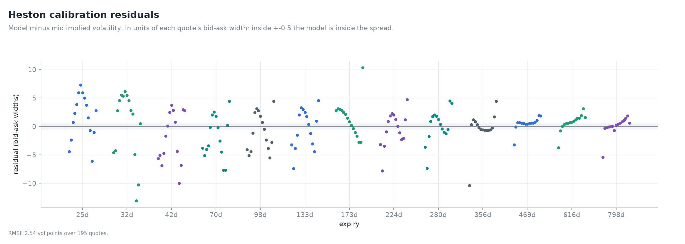
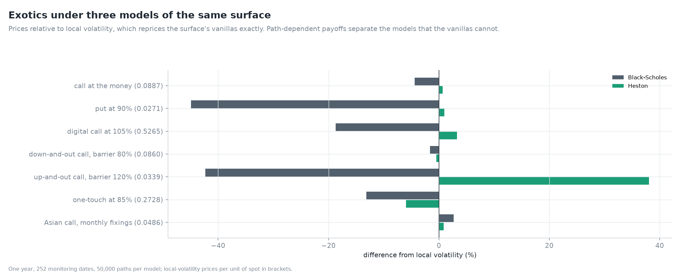

# The platform: one reproducible analysis over every engine

Eight days rebuilt the lab's engines and held each to an independent reference. Day 9 puts
them behind one command, one report and one record, so that a reader runs the rebuilt
code and can get every number again.

---

## 1. One analysis, in the order the days were built

`volsurf.platform.analysis.run` takes a source of quotes through the whole stack:

| Step | Day | What it does |
|---|---|---|
| market | 3 | parity forwards and discount factors; quotes kept or dropped for stated reasons |
| surface | 4 | raw SVI under hard butterfly and calendar constraints, joined by price interpolation |
| Heston | 5 | multistart calibration from a scrambled Sobol' design to bid-ask-weighted implied volatilities |
| SABR, local volatility | 6 | SABR expiry by expiry; Dupire local volatility in closed form |
| exotics | 7 | seven contracts under Black-Scholes, Heston and local volatility |
| hedging | 8 | a three-month call hedged in Heston and local-volatility worlds with each model's delta |
| book | 8 | a dealer book's stress under each smile dynamic; historical VaR when the history is stored |

`volsurf analyze` runs it on a stored snapshot and `volsurf demo` on a synthetic Heston
chain. The dashboard and `volsurf price` call the same engines. The v1.0 pipeline, report,
figures, calibration and hedging lab are retired; its SVI and surface survive only in
`volsurf.legacy`, to reproduce the arbitrage Day 4 found in them
([ADR 0029](../adr/0029-one-analysis-over-the-rebuilt-engines.md)).

On the synthetic chain, whose model is known, the analysis recovers it in quick mode:

| Parameter | True | Recovered |
|---|---|---|
| v0 | 0.028 | 0.0281 |
| kappa | 2.5 | 2.46 |
| theta | 0.042 | 0.0422 |
| vol of vol | 0.8 | 0.80 |
| rho | -0.74 | -0.737 |

## 2. The S&P 500, 9 October 2026


`volsurf analyze --ticker ^SPX --day 2026-10-09` takes under five minutes:

- **Surface:** 8,510 cleaned quotes on 48 expiries; median error 0.19 vol points.
- **Heston:** the Day 5 parameters again, missing by 2.54 points.
- **SABR:** 13 expiries.
- **Exotics:** seven contracts under three models.
- **Hedging:** a three-month call in two worlds.
- **Book:** stress under four smile dynamics and the one-day 99% VaR.


The report repeats the days' findings on one snapshot, from one command:

- **Heston cannot fit the short end.** Its residuals reach ten bid-ask widths and more at
  one month, and shrink to one or two widths beyond a year.

  

- **The up-and-out call is 38% dearer under Heston than under local volatility**, while
  the at-the-money call agrees to 0.7%.

  

- **The models give the three-month call deltas from 0.41 to 0.73.** Daily hedging leaves
  10% of the premium in the local-volatility world and at least 54% in the calibrated
  Heston world.

  

- **The dealer book's 10% stress ranges from $2.0m to $7.6m** with the smile dynamic. Its
  one-day 99% VaR is $456k by full revaluation and $548k from the Greeks.

  

## 3. Every number can be got again

Each run writes `manifest.json` beside its report. It holds:

- the source's fingerprint: the SHA-256 of the stored snapshot's files, or of the
  generated synthetic quotes;
- the SHA-256 of the S&P 500 and VIX history, when the VaR uses it;
- the configuration;
- the volsurf version and git commit;
- the Python, NumPy, SciPy, pandas, matplotlib and QuantLib versions;
- the timings;
- every headline number, flat and named.

`volsurf reproduce <dir>` then works in three steps:

1. It rebuilds the source, and refuses to go on if its bytes differ.
2. It reruns with the recorded configuration.
3. It compares every number to a relative 1e-6.

| Run | Numbers | Reproduced |
|---|---|---|
| S&P 500, 9 October 2026, full configuration | 52 | 52 |
| synthetic chain, quick, with hedging | 49 | 49 |
| synthetic chain, quick, without hedging (validation row) | 39 | 39 |

Every random step is seeded: the Sobol' starts and the exotic and hedging paths. A changed
input is reported as changed, with both fingerprints, and never as a numerical difference
([ADR 0030](../adr/0030-every-run-records-a-manifest-and-can-be-reproduced.md)).

## 4. The command line, the dashboard and the package

```
volsurf chains fetch ^SPX          store today's option chain
volsurf history fetch              store the S&P 500, VIX, VIX3M and bill history
volsurf analyze --ticker ^SPX      report, figures, tables and manifest
volsurf reproduce reports/SPX      rerun and compare every number
volsurf demo --quick               the same, offline, on a synthetic chain
volsurf price ...                  one contract under every engine
volsurf greeks ...                 seventeen Greeks
volsurf validate                   52 checks against independent references
volsurf gallery                    every chart in the documentation
```

`volsurf price` quotes every engine on one contract. For a six-month 95% put at 25%
volatility:

| Engine | Price |
|---|---|
| analytic | 4.082510 |
| Leisen-Reimer tree (301 steps) | 4.082507 |
| Crank-Nicolson PDE | 4.082334 |
| scrambled Sobol' Monte Carlo | 4.082548 ± 0.0001 |
| American, by the tree | 4.153 |
| American, by the PDE | 4.153 |
| American, Longstaff-Schwartz bounds | 4.140 to 4.157 |
| Heston (rho -0.5), contour integral and COS | 4.135199, agreeing to the last digit |
| Heston, QE Monte Carlo | 4.110 ± 0.025 |

**The dashboard** (`streamlit run app/streamlit_app.py`) reads stored snapshots and never
downloads on its own. Without a snapshot it starts on the synthetic chain, so it works
offline and in CI. It has six tabs:

- **Pricer:** seventeen Greeks and four engines;
- **Surface:** the interactive surface, each smile, and its arbitrage margins;
- **Models:** Heston calibration on demand, and local volatility;
- **Exotics:** a barrier by closed form, the BGK correction and Monte Carlo;
- **Hedging:** Derman-Kamal and the gamma formula;
- **Risk:** the book's stress under a chosen smile dynamic.

**The package** builds as an sdist and a wheel, declares itself typed, and passes
`twine check`. In CI the wheel is installed alone, without the development extras, and
runs `volsurf price`, `volsurf demo --quick` and `volsurf reproduce`. That check found that
the report pulled QuantLib in through the gallery's eager imports; they are now lazy
([ADR 0031](../adr/0031-the-wheel-is-tested-on-its-own.md)).

## 5. What the nine days leave

- **Engines held to independent references:** 52 checks in `volsurf validate`, against
  published values, QuantLib, 40-digit arithmetic, and properties that must hold for any
  input.
- **Thirty-one architecture decision records**, a methodology note for every day, and a
  gallery of 52 charts drawn from source.
- **One command from a stored chain to a report**, and one more to prove it reproduces.

The limits stand where the notes left them:

- Heston's short-dated skew;
- delayed, non-synchronous quotes;
- the VIX as a proxy for at-the-money volatility;
- no transaction costs.
